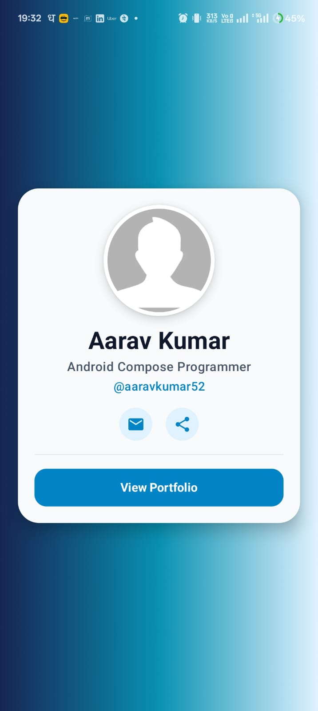
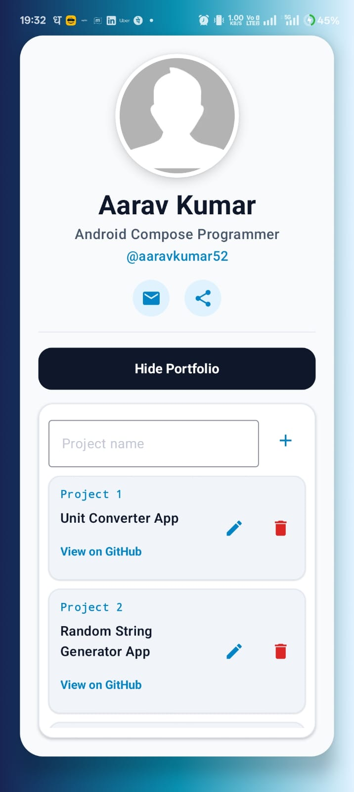

# 📱 DevFolio - Developer Portfolio Android App


**DevFolio** is a sleek, responsive, and modern Android portfolio application built entirely with **Jetpack Compose** and **Material 3**. Designed for developers to showcase their projects, social profiles, and skill sets with full CRUD (Create, Read, Update, Delete) capability and local persistence.

---

## 📸 Screenshots

| Profile Card View | Portfolio List View |
| :---: | :---: |
|  |  |

---

## ✨ Features

- 🎨 **Modern Compose UI**: Elegant Material 3 user interface with custom gradient styling, elevation cards, and smooth tap feedback.
- ⚡ **Animated Splash Screen**: Built-in splash transition loading into the main portfolio card.
- 💼 **Interactive Portfolio Section**: Toggle display of project cards dynamically.
- ➕ **Add Projects**: Seamlessly insert new project entries into your portfolio list.
- ✏️ **Edit & Update**: Full editing dialog support to modify project titles and GitHub links.
- 🗑️ **Delete Projects**: Quickly remove entries with real-time UI updates.
- 🔗 **Deep Linking / Browser Integration**: Clickable links to open project repositories directly in standard web browsers.
- 💾 **Local Data Persistence**: Persistent storage utilizing `SharedPreferences` with JSON serialization to keep portfolio data across app restarts.
- 🚀 **R8 Code & Resource Shrinking**: Optimized APK binary size via R8 full-mode shrinking and resource minimization.

---

## 🛠 Tech Stack & Libraries

- **Language**: [Kotlin](https://kotlinlang.org/)
- **UI Toolkit**: [Jetpack Compose](https://developer.android.com/jetpack/compose) (Material 3)
- **Architecture**: Single Activity Compose Architecture
- **State Management**: Compose State (`mutableStateOf`, `mutableStateListOf`, `LaunchedEffect`)
- **Persistence**: `SharedPreferences` + `org.json`
- **Build System**: Gradle KTS (Kotlin DSL)
- **Optimization**: R8 Shrinker & ProGuard Optimization

---

## 📁 Project Structure

```
DevFolio/
├── app/
│   ├── src/
│   │   ├── main/
│   │   │   ├── java/com/example/devfolio/
│   │   │   │   ├── MainActivity.kt       # Main Activity, Splash, Portfolio UI & Persistence Logic
│   │   │   │   └── ui/theme/
│   │   │   │       ├── Color.kt          # Color palette definitions
│   │   │   │       ├── Theme.kt          # Material3 Theme configuration
│   │   │   │       └── Type.kt           # Typography configurations
│   │   │   ├── res/                      # Drawable resources & launchers
│   │   │   └── AndroidManifest.xml
│   │   └── test/                         # Unit tests
│   ├── build.gradle.kts                  # App module dependencies & R8 config
│   └── proguard-rules.pro                # R8 Optimization rules
├── screenshots/                          # App Preview Screenshots
│   ├── profile_card.jpeg
│   └── portfolio_list.jpeg
├── gradle.properties                     # R8 & Gradle optimization flags
├── build.gradle.kts                      # Root Gradle configuration
└── README.md                             # Project Documentation
```

---

## 🚀 Getting Started

### Prerequisites

- **Android Studio**: Ladybug (2024.2+) or newer
- **JDK**: Version 17 or higher
- **Android SDK**: Compile SDK 37, Min SDK 28

### Installation & Build

1. **Clone the Repository**:
   ```bash
   git clone https://github.com/aaravkumar52/DevFolio.git
   cd DevFolio
   ```

2. **Open in Android Studio**:
   - Launch Android Studio, select **Open**, and navigate to the `DevFolio` directory.

3. **Build & Run**:
   - Build Debug APK:
     ```bash
     ./gradlew assembleDebug
     ```
   - Build Release APK (with R8 shrinking):
     ```bash
     ./gradlew assembleRelease
     ```

---

## 📄 License

```text
Copyright 2025 Aarav Kumar

Licensed under the Apache License, Version 2.0 (the "License");
you may not use this file except in compliance with the License.
You may obtain a copy of the License at

    http://www.apache.org/licenses/LICENSE-2.0

Unless required by applicable law or agreed to in writing, software
distributed under the License is distributed on an "AS IS" BASIS,
WITHOUT WARRANTIES OR CONDITIONS OF ANY KIND, either express or implied.
See the License for the specific language governing permissions and
limitations under the License.
```
